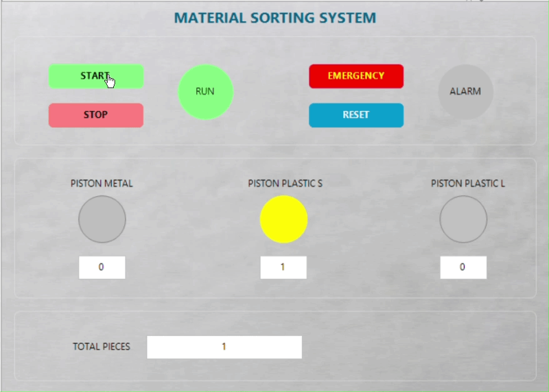
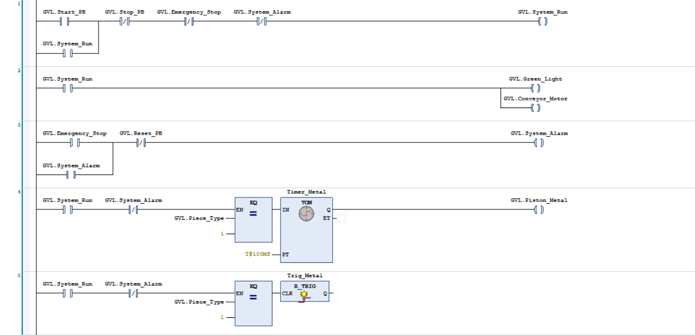
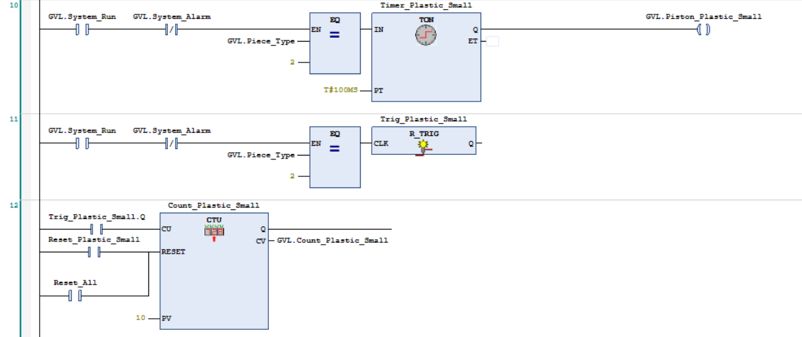
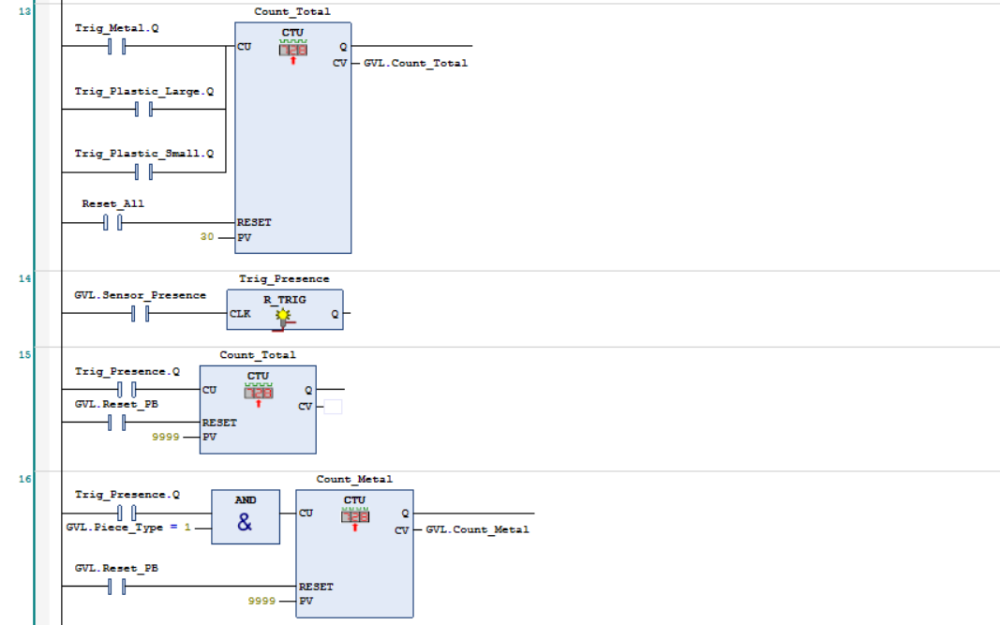

# 🏭 codesys-sorting-station-plc
Automated sorting station developed in CODESYS using Ladder Diagram (LD), Structured Text (ST), and integrated HMI.

## 📋 Overview
This repository contains the automation logic and HMI implementation for an **Automated Sorting Station**, developed entirely within the **CODESYS V3.5** environment using **Ladder Diagram (LD)** and **Structured Text (ST)**.

The project focuses on a standalone PLC and HMI architecture, managing a conveyor belt system, sensor-based material detection, pneumatic actuators for sorting, and real-time production tracking.

---

## 📽️ HMI Demonstration

---

## ⚡ Control Logic & Key Features
The PLC program implemented within `PLC_PRG` and global variable lists (`GVL`) handles the following core functionalities:
- **System Management & Safety:** Start, Stop, Emergency Stop, and Reset routines, alongside system status flags (`GVL.System_Run`, `GVL.System_Alarm`, `GVL.Green_Light`).
- **Conveyor & Trigger Control:** Management of the conveyor motor and rising edge detection (`R_TRIG`) linked to the presence sensor (`Trig_Presence`).
- **Material Classification:** Evaluation of piece characteristics using inductive and height sensors (`GVL.Sensor_Inductive`, `GVL.Sensor_Height`) to assign a specific type code (`Piece_Type`).
- **Pneumatic Sorting Actuation:** Precise timing configurations (`TON` blocks) to control sorting mechanisms via dedicated pistons (`GVL.Piston_Metal`, `GVL.Piston_Plastic_Large`, `GVL.Piston_Plastic_Small`).
- **Production Counting:** Up-counters (`CTU`) tracking processed parts per category and total volume (`Count_Metal`, `Count_Plastic_Large`, `Count_Plastic_Small`, `Count_Total`).

---

## 🛠️ System Architecture & Code Structure

### 1. Global Variable List (GVL)

---

### 2. Simulation Program (Structured Text)
Process simulation and sensor pulse generation:

---

### 3. Ladder Control Implementation (LD)
The core automation logic is split into modular networks:

* **Start/Stop & Safety Logic:**
  

* **Sorting & Actuators Logic:**
  

* **Counters & Triggers:**
  

---

## 💻 Technical Environment
- **PLC Environment:** CODESYS V3.5
- **Programming Languages:** Ladder Diagram (LD) & Structured Text (ST) - IEC 61131-3
- **HMI:** Integrated CODESYS Visualization for local operator control and monitoring.
