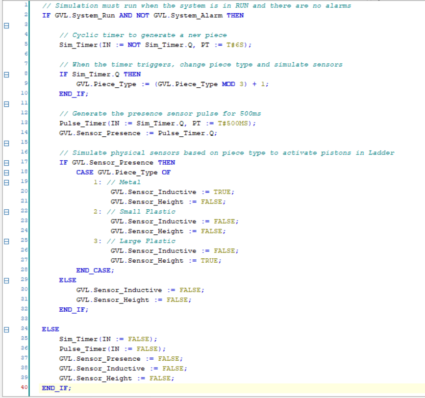
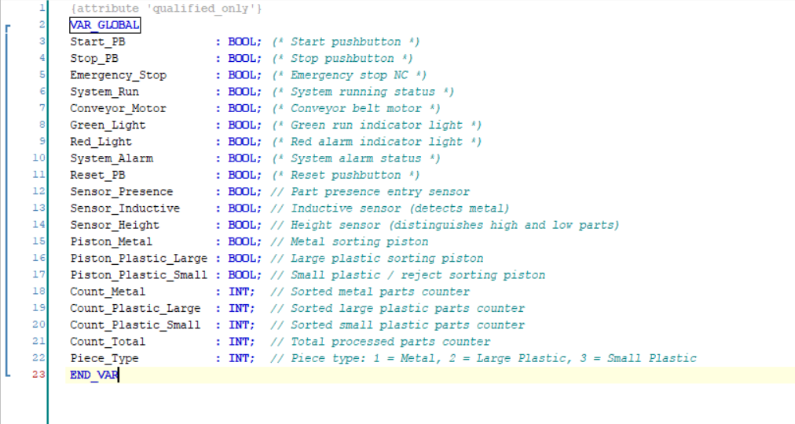

# 🏭 CODESYS Sorting Station PLC

Automated sorting station developed in **CODESYS V3.5** using **Ladder Diagram (LD)**, **Structured Text (ST)** and an integrated **HMI Visualization**.

---

## 📋 Project Overview

This project simulates an automated material sorting station controlled by a PLC.

The system detects incoming parts, classifies them according to sensor inputs, activates dedicated pneumatic sorting pistons, and tracks production statistics through a real-time HMI.

---

## 🚀 Features

✅ Start / Stop control

✅ Emergency Stop & Reset

✅ Conveyor Belt Management

✅ Material Classification

✅ Pneumatic Sorting System

✅ Production Counters (CTU)

✅ Sensor Simulation in Structured Text

✅ Integrated HMI Visualization

---

## 🎥 HMI Demonstration


The HMI allows the operator to:

- Start and stop the system
- Trigger emergency and reset functions
- Monitor system status
- Visualize piston activations
- Monitor real-time production counters

---

## ⚡ PLC Logic

### Start / Stop & Safety Logic


This section manages:

- Start / Stop commands
- Emergency Stop
- Alarm handling
- Self-holding (latching) circuit
- Conveyor activation

---

### Material Classification Logic


Parts are classified using:

- Presence Sensor
- Inductive Sensor
- Height Sensor
- Rising Edge Detection (R_TRIG)

The system assigns the detected part to a specific category using the `Piece_Type` variable.

---

### Sorting & Production Counting


Sorting logic includes:

- TON timers
- Pneumatic piston activation
- CTU counters
- Production statistics

---

## ⚙️ Structured Text Simulation



A Structured Text module automatically generates virtual parts for testing and demonstration purposes.

Functions implemented:

- Cyclic part generation
- Sensor simulation
- Piece type selection
- Presence pulse generation
- Automatic testing of the sorting process

---

## 📊 Variable Structure



Main variables include:

- `System_Run`
- `System_Alarm`
- `Sensor_Presence`
- `Sensor_Inductive`
- `Sensor_Height`
- `Piston_Metal`
- `Piston_Plastic_Large`
- `Piston_Plastic_Small`
- `Count_Metal`
- `Count_Plastic_Large`
- `Count_Plastic_Small`
- `Count_Total`

---

## 🛠️ Technologies Used

- CODESYS V3.5
- Ladder Diagram (LD)
- Structured Text (ST)
- IEC 61131-3
- HMI Visualization
- TON Timers
- CTU Counters
- R_TRIG Edge Detection

---

## 📂 Repository Structure

```text
codesys-sorting-station-plc/
│
├── README.md
├── assets/
│   ├── hmi_demo.gif
│   ├── ladder_start_stop.png
│   ├── ladder_classification.png
│   ├── ladder_sorting.png
│   ├── st_simulation.png
│   └── gvl.png
│
└── project/
    └── sorting_station.project
```

---

## 📈 Skills Demonstrated

- PLC Programming
- Industrial Automation
- Ladder Logic Development
- Structured Text Programming
- HMI Design
- Sensor Integration
- Pneumatic Actuator Control
- Production Monitoring
- Industrial Safety Logic

---
